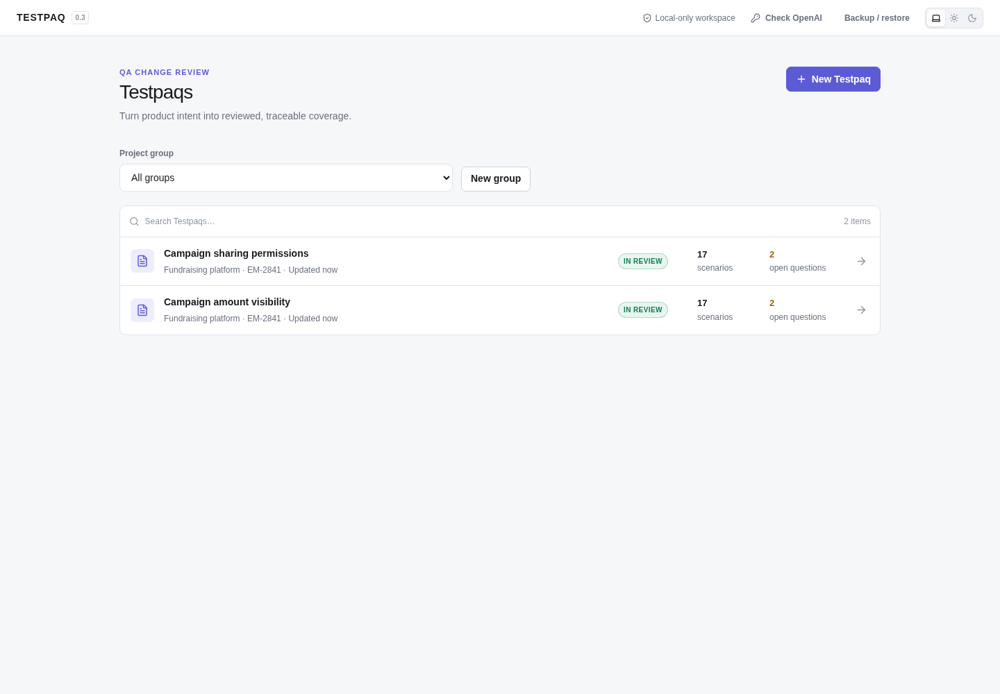
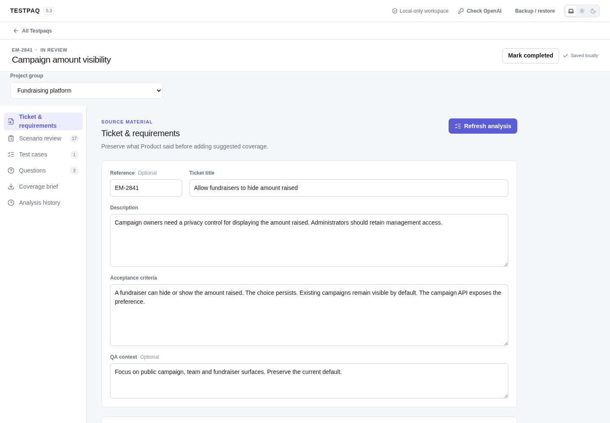
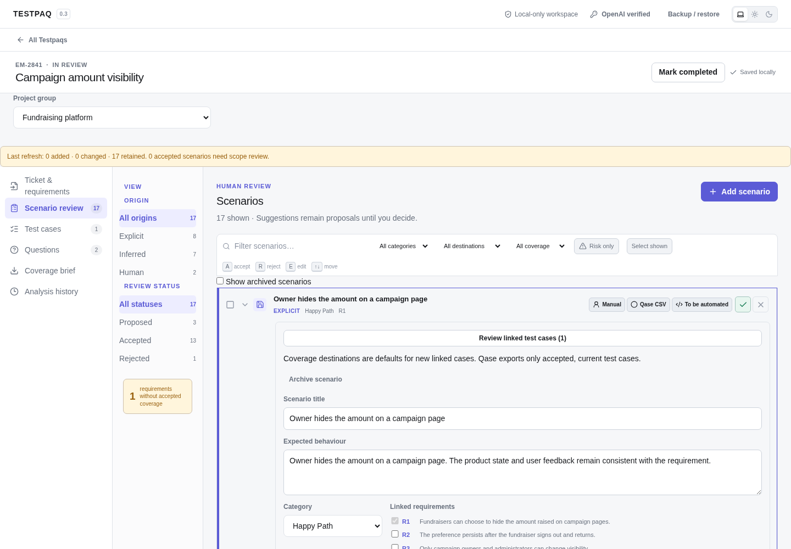
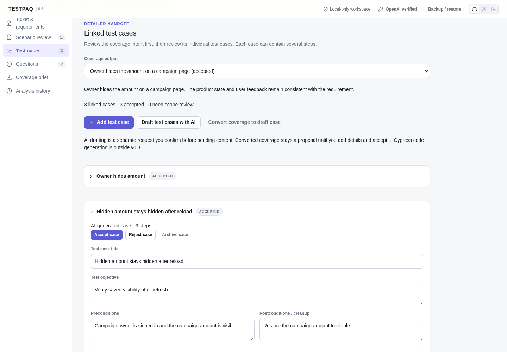
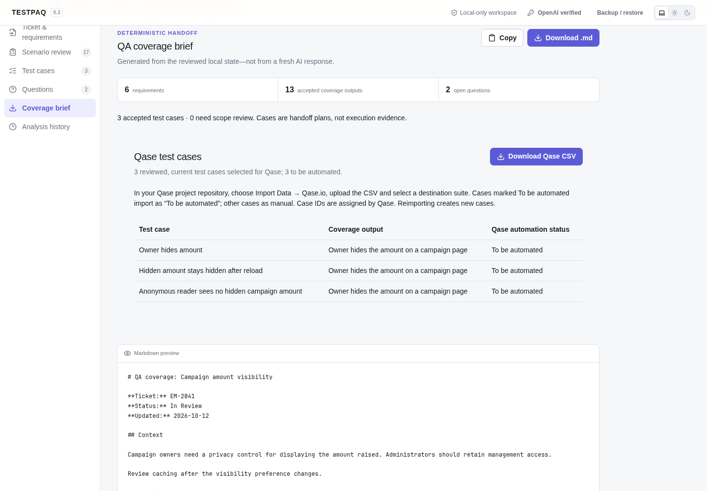
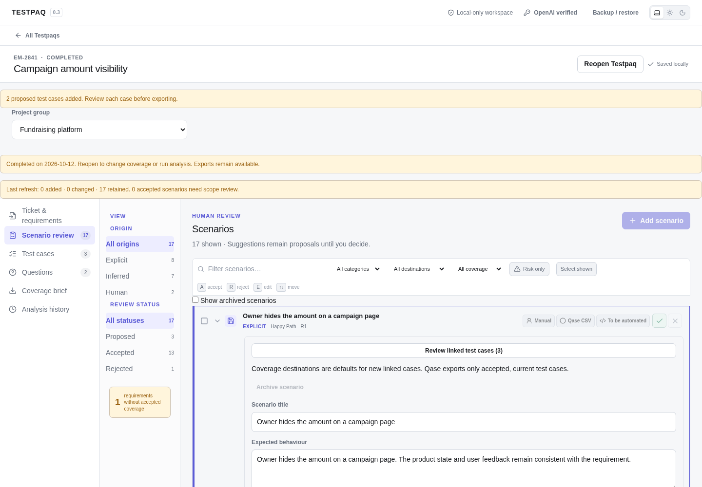
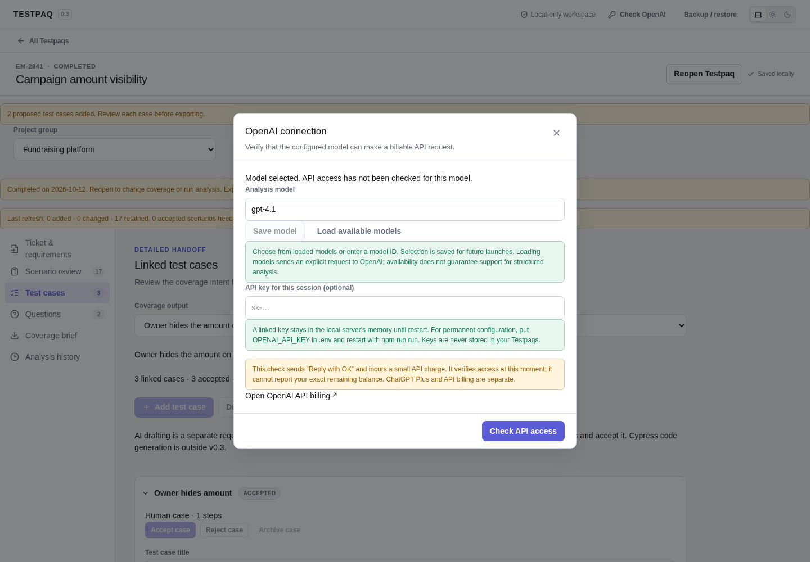
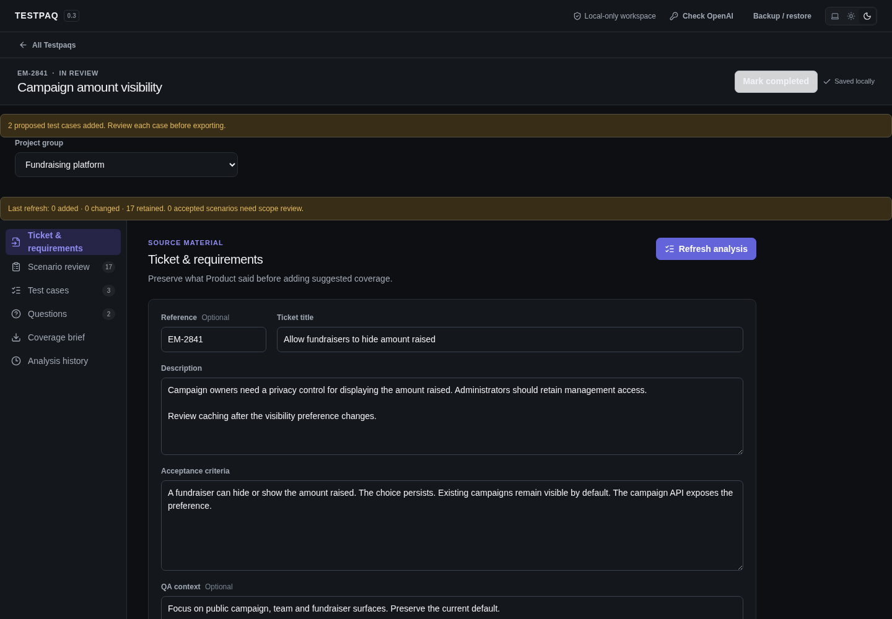
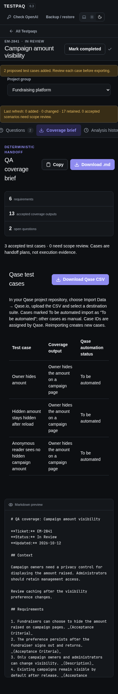

# Testpaq

Turn a product ticket into a QA review you can explain and hand off.

Testpaq keeps tickets, requirements, test scenarios and open questions together in a local workspace. AI can propose coverage; you decide what to keep, how to test it and when the review is complete.

## Get started

You need **Node.js 22 or newer** and npm. An OpenAI API key is optional: you can write and review everything manually.

```bash
cp .env.example .env
# Optional: add your OPENAI_API_KEY to .env
npm run run
```

Testpaq installs dependencies, builds and opens in your browser. Use the same command next time. Your work stays in a local SQLite database. Stop the app with `Ctrl+C`; use `npm run run -- --no-open` if you prefer to open the browser yourself.

## A typical review

1. Create a Testpaq and paste your ticket. Organise related work into project groups.
2. Clarify the requirements yourself or choose **Analyse ticket**. Before AI runs, you see the model and what content will be sent.
3. Accept, reject or edit the proposed scenarios. Answer open questions and refresh analysis when scope changes. Review decisions and human edits survive refreshes; affected accepted cases get a scope-review reminder.
4. Open **Test cases** for an accepted coverage output. Add cases manually or confirm **Draft test cases with AI**. One output can have several cases; each case has its own setup, data, steps and expected results.
5. Review each case, resolve missing details and choose **Qase CSV** or **To be automated in Qase**. Open **Coverage brief** to preview and download the handoff.
6. Choose **Mark completed** when the review is finished. You can still read, filter and export it; **Reopen Testpaq** lets you make changes.

Completion records your review decision. It does not claim tests have run or passed.

## Linked test cases and Qase handoff

Accepting a coverage output agrees that the behaviour needs testing. Accepting its linked cases agrees how to test it. AI-generated cases start as proposals; content edits return an accepted case to Proposed. Changed ticket scope, linked requirements or recorded answers flag cases for review. Existing decisions and human edits survive refresh and additional drafting.

| Test case selection                                                | Qase CSV result                      |
| ------------------------------------------------------------------ | ------------------------------------ |
| Accepted, current + Qase CSV                                       | Manual test case                     |
| Accepted, current + To be automated                                | Test case marked **To be automated** |
| Both selections                                                    | One case, marked **To be automated** |
| Manual only, proposed, rejected, archived or awaiting scope review | Excluded                             |

The parent coverage output must also be accepted, current and unarchived. Existing coverage summaries are preserved; **Convert coverage to draft case** creates a proposal for you to flesh out and review. A coverage summary alone no longer becomes a Qase case.

Inspect the inclusion preview, then choose **Download Qase CSV**. In your Qase project repository, select **Import Data → Qase.io**, upload the file and choose a parent suite. Every selected case becomes one native Qase v2 record with preconditions, postconditions, ordered actions/data/results, requirement references, provenance and stable local IDs.

The CSV creates new cases: importing it twice can create duplicates. **Cypress implementation is outside v0.3.** To be automated is a planning flag; Testpaq does not generate or execute automation, or write directly to Qase. See [Qase's import format](https://docs.qase.io/en/articles/14441496-qase-csv-adding-test-steps).

You can also copy or download a Markdown coverage brief for a ticket, pull request or review discussion.

## Choose your AI model

Open the OpenAI settings in the top bar. Enter a model ID, or choose **Load available models** for account suggestions, then **Save model**. Your choice survives restarts. Saving is local; loading models contacts OpenAI. Some listed models may not support the structured responses needed for analysis.

**Check access** makes a small billable request. Analysis also uses your API account. Neither happens automatically at startup. A key entered through the dialog stays in server memory until restart; a key in `.env` is available on subsequent launches.

## Keep your work safe

Edits save automatically. If a save fails, use **Retry save**. A browser draft buffer preserves pending edits across reloads and offers a comparison when another tab has changed the same Testpaq. Resolve overlapping edits before saving the merged draft.

Use **Backup / restore** to download the complete workspace, including groups, analysis history and model preference. Keep the file somewhere safe: it contains your ticket content, but no API key. Restoring replaces the workspace; the server first creates a local safety snapshot. Database migrations also make a local snapshot, and a second app instance cannot open the same database concurrently.

AI requests send the disclosed ticket, requirements, questions/answers and scenarios to OpenAI. Manual work stays local. Testpaq has no cloud sync or telemetry; OpenAI requests use `store: false`.

## Gallery

These are screenshots of the running app with synthetic example data. No real customer content or external AI calls were used.

### Your workspace



### Ticket and requirements



### Review scenarios



### Detailed test cases



### Qase export



### Completed review



### Model settings



<details>
<summary>Dark theme and mobile view</summary>





</details>

## Development and review evidence

For configuration, data locations and architecture, see [the technical guide](docs/DEVELOPMENT.md). Run the checks with:

```bash
npm run lint
npm run typecheck
npm test
npm run build
npm run format:check
```

`npm run test:browser` exercises the built app with a synthetic provider. Install Chromium with `npx playwright install chromium`, or set `TESTPAQ_BROWSER_PATH` to an installed Chromium executable. `npm run gallery` repeats that workflow and captures the screenshots above.

The [whole-app forensic review](FORENSIC_REVIEW.md) records the findings before fixes. The [remediation report](REMEDIATION.md) explains the fixes and validation. Live OpenAI generation and a real Qase import still require integration verification with your account.
