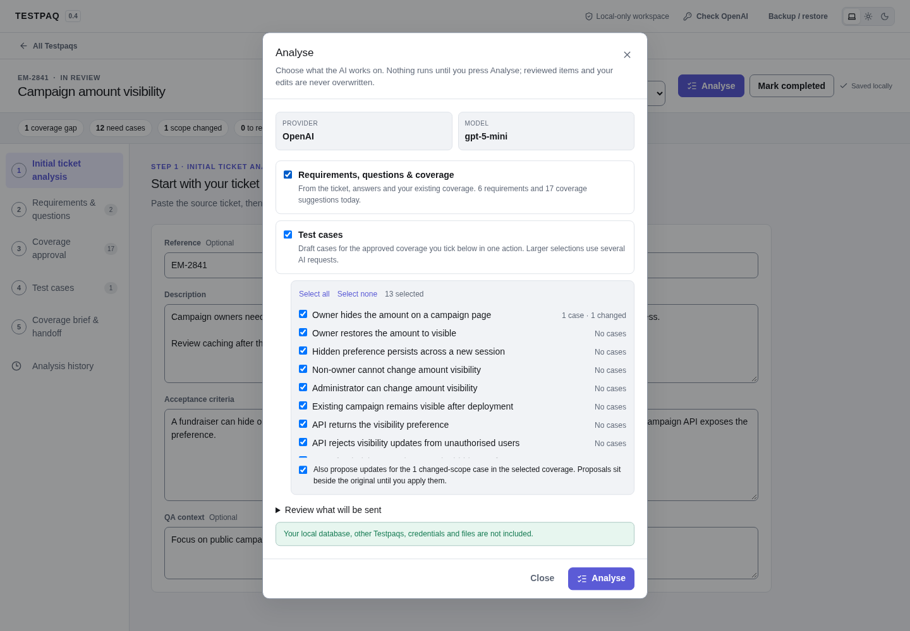
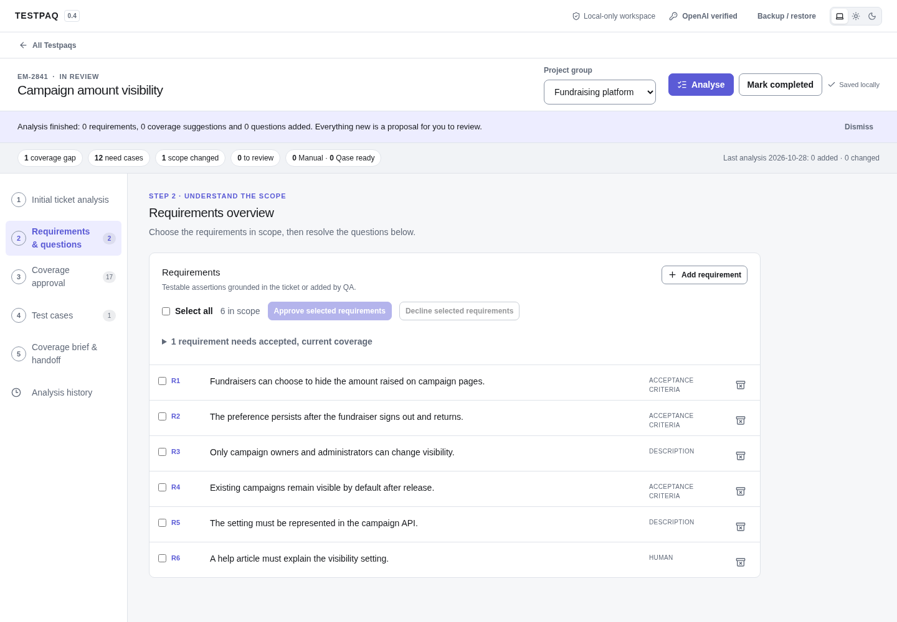
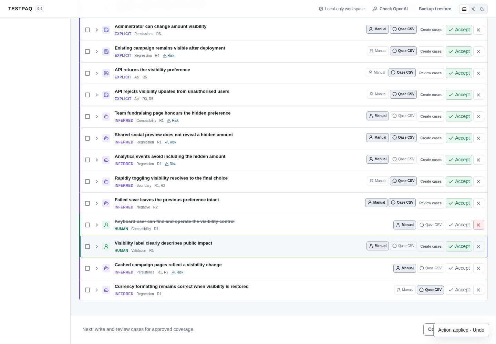
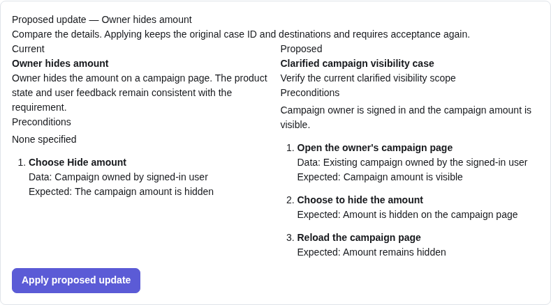

# Testpaq

Turn a product ticket into a QA review you can explain and hand off.

Testpaq keeps tickets, requirements, test scenarios and open questions together in a local workspace. AI can propose coverage; you decide what to keep, how to test it and when the review is complete.

## Get started

You need **Node.js 22 or newer** and npm. An OpenAI API key is optional: you can write and review everything manually.

```bash
cp .env.example .env
# Optional: add your OPENAI_API_KEY to .env
npm run run
```

Testpaq installs dependencies, builds and opens in your browser. Use the same command next time. Your work stays in a local SQLite database. Stop the app with `Ctrl+C`; use `npm run run -- --no-open` if you prefer to open the browser yourself.

## A typical review

1. Create a Testpaq and paste the ticket and acceptance criteria into **Initial ticket analysis**. Nothing is sent to AI yet.
2. Choose **Analyse** whenever you want help. One dialog lets you pick what the AI works on: **Requirements, questions & coverage** from the ticket, and/or **Test cases** for the approved coverage you tick. Case drafts and changed-scope updates run in one action. Larger selections use one AI request per six coverage outputs, plus a separate request if ticket analysis is selected. Testpaq never starts analysis, or asks you to, after another action; an **Out of date** marker on the Analyse button simply shows the ticket, requirements or answers changed since the last run. The model and content disclosure appear before anything is sent.
3. In **Requirements & questions**, confirm the scope and answer open questions. **Select all** lets you approve or decline requirements together; unfinished requirements must be authored before approval.
4. In **Coverage approval**, approve, decline or edit proposed scenarios. Use **Select all shown** for bulk decisions. Manual and Qase selections on coverage supply defaults for new cases.
5. In **Test cases**, every case is listed in one place, grouped by coverage. Add a case yourself or review the ones Analyse drafted. A case has a title, a description, preconditions and ordered steps (action, optional test data, expected result). Choose Manual, Qase or both for handoff. Bulk approval is available for complete, current cases; changed scope and proposed updates need individual review. Applying a proposed update shows the current and proposed case side by side.
6. Use **Coverage brief & handoff** to download Manual cases or Qase CSV. The status strip under the title shows gaps, cases still to write or review, and what is ready for each handoff. **Mark completed** shows a summary before closing; **Reopen Testpaq** lets you make changes.

Completion records your review decision. It does not claim tests have run or passed.

Each Testpaq holds up to 3,000 cases, including archived cases and update proposals. At that limit, AI case drafting is blocked before a request is sent; existing cases can still be edited and requirements analysis remains available. When a response exceeds the available space, requested update proposals are saved first. The result and analysis history report what was saved, what was not returned, and what could not be saved because of the limit. Returned drafts that could not be saved remain available to inspect in history.

Choose up to 200 coverage outputs per analysis. Answers keep their requirement or coverage scope, and rejected or archived cases do not count as current coverage when drafting replacements. If ticket analysis makes selected coverage need approval again, the completion notice explains which case drafting was skipped; nothing prompts you to run it again automatically. Adding coverage or a question reveals the new item even when the previous view used filters.

Large Testpaqs use incremental autosaves and compact scope fingerprints, so repeating ticket context across cases does not block later edits. Older recorded scope remains valid and still detects changes. AI output has separate response and whole-run budgets. If a later request fails or reaches its output limit, no cases from that batch are applied; completed earlier responses remain inspectable in analysis history.

## Linked test cases and Qase handoff

Accepting a coverage output agrees that the behaviour needs testing. Accepting its linked cases agrees how to test it. AI-drafted cases start as proposals; content edits return an accepted case to Proposed. Changed ticket scope, linked requirements or recorded answers flag cases for review. Existing decisions and human edits survive re-analysis and additional drafting. AI cases are written to be terse: no rationale or commentary, and nothing that is not part of the test.

| Test case selection                                          | Handoff                                    |
| ------------------------------------------------------------ | ------------------------------------------ |
| Accepted, current + Manual                                   | Included in the Manual case download       |
| Accepted, current + Qase CSV                                 | Included in Qase CSV as a manual test case |
| Both selections                                              | Included in both handoffs                  |
| Proposed, rejected, archived, stale or an unapplied revision | Excluded                                   |

Historical v0.3 **To be automated** plans are preserved in Qase CSV and shown in its inclusion preview. The Qase checkbox includes those plans; deselecting Qase clears that case's historical automation selection as well. Testpaq offers only Manual and Qase destinations.

New cases use Manual/Qase defaults only. An older parent’s automation intention supplies a Qase default, without marking the new case To be automated. Revisions preserve the original case’s destinations.

The parent coverage output must also be accepted, current and unarchived.

**Only test content is exported.** Both the Manual download and the Qase CSV contain each case's title, description, preconditions and steps, and nothing else: no ticket or requirement text, rationale, risks, IDs, provenance or review status. Postconditions are not exported. The Qase CSV uses Qase's legacy (V1) layout: an `id` first column and plain numbered steps ("1. Open the page") in the `steps_actions`, `steps_results` and `steps_data` cells, rather than V2's per-step encoding. It writes only the columns it needs; the exact legacy column set has not been confirmed against a live import.

Inspect the inclusion preview, then choose **Download Qase CSV**. In your Qase project repository, select **Import Data → Qase.io CSV [deprecated]**, upload the file and choose a parent suite. The file uses Qase's legacy (V1) layout, so do not pick the plain "Qase.io" source, which expects the V2 step encoding. The CSV creates new cases: importing it twice can create duplicates. Testpaq does not generate or execute automation, or write directly to Qase. See [Qase's import format](https://docs.qase.io/en/articles/14441496-qase-csv-adding-test-steps).

You can also copy or download a Markdown coverage brief for a ticket, pull request or review discussion; its test case section uses the same lean case format.

Use the workspace list to archive finished work or duplicate a Testpaq for a fresh review. Copies preserve content and links, with coverage and cases returned to Proposed.

## Choose your AI model

Open the OpenAI settings in the top bar. Enter a model ID, or choose **Load available models** for account suggestions, then **Save model**. Your choice survives restarts. Saving is local; loading models contacts OpenAI. Some listed models may not support the structured responses needed for analysis.

**Check access** makes a small billable request. Analysis also uses your API account. Neither happens automatically at startup. A key entered through the dialog stays in server memory until restart; a key in `.env` is available on subsequent launches.

## Keep your work safe

Edits save automatically. If a save fails, use **Retry save**. A browser draft buffer preserves pending edits across reloads and offers a comparison when another tab has changed the same Testpaq. Choose which value to keep for each overlapping field before saving the merged draft. Navigating away saves pending work or offers draft recovery if saving fails.

Use **Backup / restore** to download the complete workspace. Pending edits in this tab must save successfully first. The backup includes groups, Testpaqs, analysis history and model preference. Keep the file somewhere safe: it contains your ticket content, but no API key. Restoring replaces the workspace; the server first creates a local safety snapshot. Other open tabs pause editing after a restore and offer their retained drafts for download. Reload those tabs to use the restored workspace. Database migrations also make a local snapshot, and a second app instance cannot open the same database concurrently.

AI requests send the disclosed ticket, requirements, questions/answers and scenarios to OpenAI. Manual work stays local. Testpaq has no cloud sync or telemetry; OpenAI requests use `store: false`.

## Gallery

These are screenshots of the running app with synthetic example data. No real customer content or external AI calls were used.

### Your workspace


### Initial ticket analysis


### Choose what to analyse



### Review scenarios


### Requirements and questions



### Coverage approval



### Review a proposed update



### Detailed test cases


### Qase export


### Completed review


### Model settings


<details>
<summary>Dark theme and mobile view</summary>


</details>
